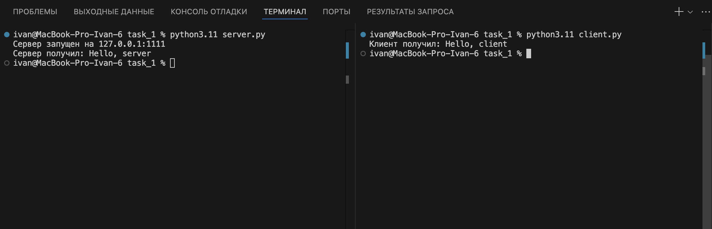
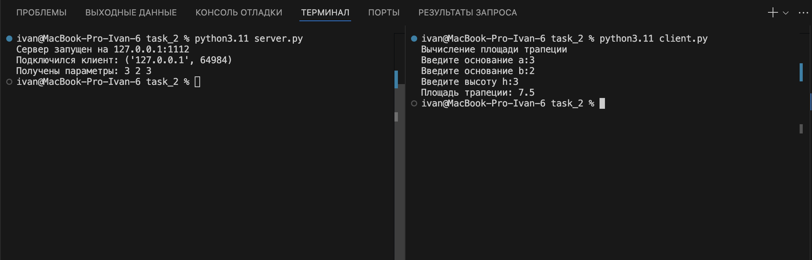
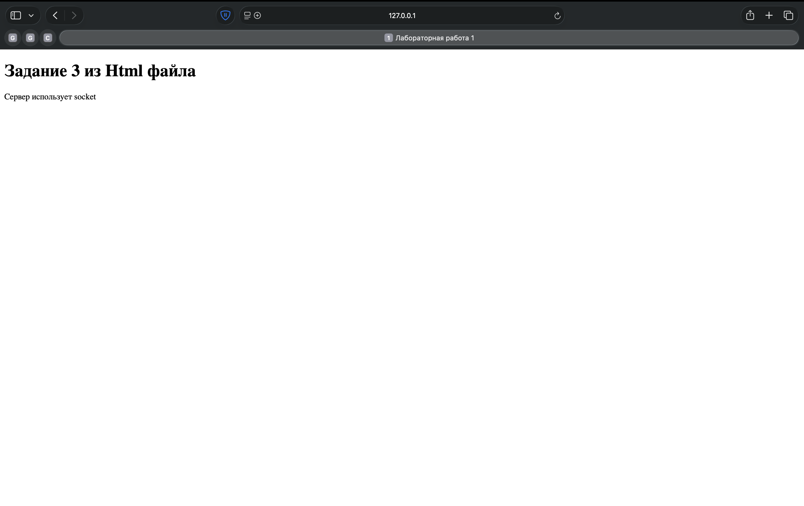
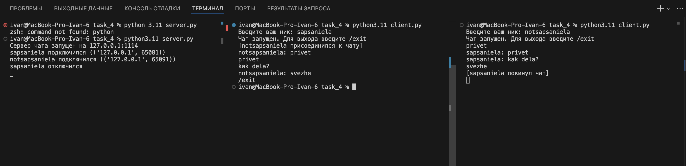
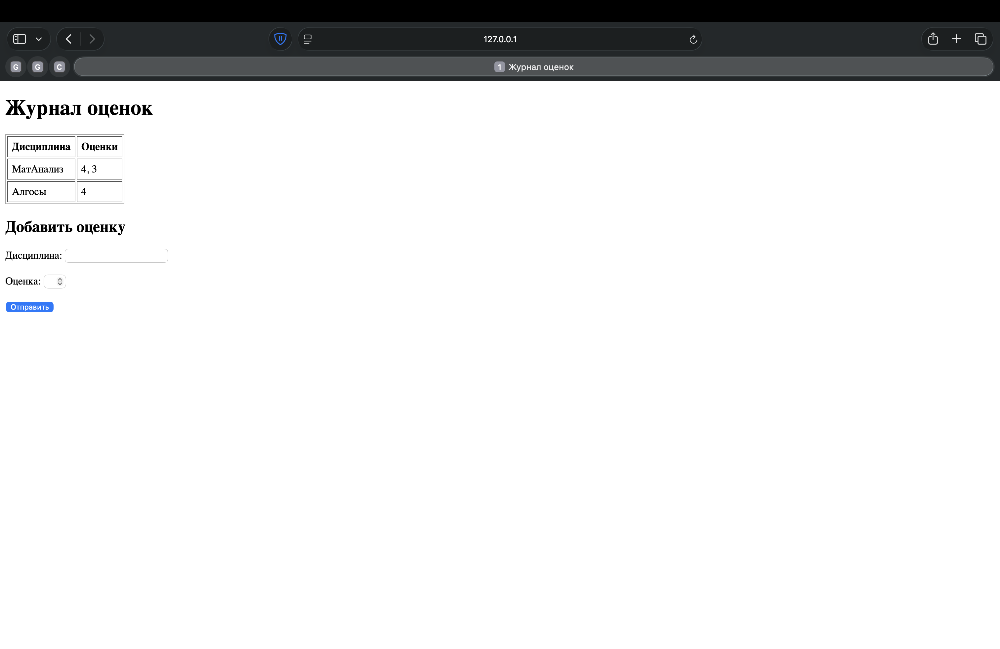

# Лабораторная работа 1. Работа с сокетами

**Студент:** Андреевский Иван  
**Группа:** К3339

**Цель:** понять принципы межсокетного взаимодействия и реализовать базовую архитектуру клиент-сервер с помощью библиотеки `socket`.

---

## Задание 1. Обмен сообщениями по UDP

Клиент отправляет серверу «Hello, server», сервер отвечает «Hello, client».

UDP (`SOCK_DGRAM`) работает без установления соединения. Сервер занимает порт через `bind()` и ждёт датаграмму в `recvfrom()`, который возвращает данные и адрес отправителя. По этому адресу сервер отвечает через `sendto()`.

### server.py

```python
import socket

HOST = "127.0.0.1"
PORT = 1111

server = socket.socket(socket.AF_INET, socket.SOCK_DGRAM)
server.bind((HOST, PORT))
print(f"Сервер запущен на {HOST}:{PORT}")

data, client_addr = server.recvfrom(1024)
print("Сервер получил:", data.decode("utf-8"))

server.sendto("Hello, client".encode("utf-8"), client_addr)

server.close()
```

### client.py

```python
import socket

SERVER_ADDR = ("127.0.0.1", 1111)

client = socket.socket(socket.AF_INET, socket.SOCK_DGRAM)
client.sendto("Hello, server".encode("utf-8"), SERVER_ADDR)

data, _ = client.recvfrom(1024)
print("Клиент получил:", data.decode("utf-8"))

client.close()
```



---

## Задание 2. Вычисления через TCP

Вариант 3: площадь трапеции, `S = (a + b) / 2 · h`. Параметры вводятся на клиенте, вычисление выполняется на сервере.

TCP (`SOCK_STREAM`) требует соединения: сервер вызывает `listen()` и `accept()`, клиент вызывает `connect()`. `accept()` возвращает новый сокет `conn` для общения с клиентом. Параметры передаются одной строкой через пробел, сервер разбирает её через `split()`.

### server.py

```python
import socket

HOST = "127.0.0.1"
PORT = 1112


def calculate_T_Area(a, b, h):
    return ((a + b) / 2) * h


server = socket.socket(socket.AF_INET, socket.SOCK_STREAM)
server.setsockopt(socket.SOL_SOCKET, socket.SO_REUSEADDR, 1)
server.bind((HOST, PORT))
server.listen()
print(f"Сервер запущен на {HOST}:{PORT}")

conn, addr = server.accept()
print("Подключился клиент:", addr)

data = conn.recv(1024).decode("utf-8")
print("Получены параметры:", data)

try:
    a_str, b_str, h_str = data.split()
    a, b, h = float(a_str), float(b_str), float(h_str)
    area = calculate_T_Area(a, b, h)
    result = f"Площадь трапеции: {area}"
except ValueError:
    result = "Ошибка: некорректные данные"

conn.sendall(result.encode("utf-8"))

conn.close()
server.close()
```

### client.py

```python
import socket

HOST = "127.0.0.1"
PORT = 1112

client = socket.socket(socket.AF_INET, socket.SOCK_STREAM)
client.connect((HOST, PORT))

print("Вычисление площади трапеции")
a = input("Введите основание a:")
b = input("Введите основание b:")
h = input("Введите высоту h:")

message = f"{a} {b} {h}"
client.sendall(message.encode("utf-8"))

data = client.recv(1024)
print(data.decode("utf-8"))

client.close()
```



---

## Задание 3. Раздача HTML-страницы по HTTP

Сервер отвечает на подключение HTTP-сообщением со страницей из `index.html`.

HTTP-ответ собирается вручную: строка статуса, заголовки, пустая строка и тело. `Content-Length` считается в байтах, так как кириллица в UTF-8 занимает два байта на символ.

### server.py

```python
import socket

HOST = "127.0.0.1"
PORT = 1113

server = socket.socket(socket.AF_INET, socket.SOCK_STREAM)
server.setsockopt(socket.SOL_SOCKET, socket.SO_REUSEADDR, 1)
server.bind((HOST, PORT))
server.listen()
print(f"Сервер запущен: http://{HOST}:{PORT}")

while True:
    conn, addr = server.accept()
    request = conn.recv(4096)

    with open("index.html", "r", encoding="utf-8") as f:
        body = f.read().encode("utf-8")

    headers = (
        "HTTP/1.1 200 OK\r\n"
        "Content-Type: text/html; charset=utf-8\r\n"
        f"Content-Length: {len(body)}\r\n"
        "Connection: close\r\n"
        "\r\n"
    ).encode("utf-8")

    conn.sendall(headers + body)
    conn.close()
```

### index.html

```html
<!DOCTYPE html>
<html lang="ru">
<head>
    <meta charset="utf-8">
    <title>Лабораторная работа 1</title>
</head>
<body>
    <h1>Задание 3 из Html файла</h1>
    <p>Сервер использует socket</p>
</body>
</html>
```



---

## Задание 4. Многопользовательский чат

Чат на TCP с потоками. Пользователь вводит ник при подключении и выходит командой `/exit`.

Сервер для каждого клиента запускает отдельный поток и хранит подключения в словаре `{сокет: ник}`, защищённом `threading.Lock`. Сообщение рассылается всем, кроме отправителя. Клиент один для всех пользователей: один поток отправляет сообщения, второй принимает.

### server.py

```python
import socket
import threading

HOST = "127.0.0.1"
PORT = 1114

server = socket.socket(socket.AF_INET, socket.SOCK_STREAM)
server.setsockopt(socket.SOL_SOCKET, socket.SO_REUSEADDR, 1)
server.bind((HOST, PORT))
server.listen()
print(f"Сервер чата запущен на {HOST}:{PORT}")

clients = {}
clients_lock = threading.Lock()


def broadcast(message, exclude_conn=None):
    with clients_lock:
        for conn in list(clients.keys()):
            if conn is exclude_conn:
                continue
            try:
                conn.sendall(message.encode("utf-8"))
            except OSError:
                pass


def handle_client(conn, addr):
    try:
        conn.sendall("Введите ваш ник: ".encode("utf-8"))
        nickname = conn.recv(1024).decode("utf-8").strip()

        with clients_lock:
            clients[conn] = nickname
        print(f"{nickname} подключился ({addr})")
        broadcast(f"[{nickname} присоединился к чату]\n", exclude_conn=conn)

        while True:
            data = conn.recv(1024)
            if not data:
                break

            text = data.decode("utf-8").strip()
            if not text:
                continue

            if text == "/exit":
                break

            broadcast(f"{nickname}: {text}\n", exclude_conn=conn)

    except ConnectionResetError:
        pass
    finally:
        with clients_lock:
            nickname = clients.pop(conn, "Неизвестный")
        print(f"{nickname} отключился")
        broadcast(f"[{nickname} покинул чат]\n", exclude_conn=conn)
        conn.close()


while True:
    conn, addr = server.accept()
    thread = threading.Thread(target=handle_client, args=(conn, addr), daemon=True)
    thread.start()
```

### client.py

```python
import socket
import threading

HOST = "127.0.0.1"
PORT = 1114


def receive_messages(sock):
    while True:
        try:
            data = sock.recv(1024)
            if not data:
                print("Соединение с сервером закрыто")
                break
            print(data.decode("utf-8"), end="")
        except OSError:
            break


def main():
    sock = socket.socket(socket.AF_INET, socket.SOCK_STREAM)
    sock.connect((HOST, PORT))

    prompt = sock.recv(1024).decode("utf-8")
    nickname = input(prompt)
    sock.sendall(nickname.encode("utf-8"))

    thread = threading.Thread(target=receive_messages, args=(sock,), daemon=True)
    thread.start()

    print("Чат запущен. Для выхода введите /exit")
    while True:
        message = input()
        try:
            sock.sendall(message.encode("utf-8"))
        except OSError:
            break
        if message == "/exit":
            break

    sock.close()


if __name__ == "__main__":
    main()
```



---

## Задание 5. Веб-сервер для обработки GET и POST

Сервер принимает оценки по дисциплинам (POST) и отдаёт журнал в виде HTML-страницы (GET).

Запрос разбирается вручную: из первой строки берётся метод, тело POST читается после пустой строки и дочитывается по `Content-Length`, так как может прийти отдельным пакетом. Оценки хранятся в словаре `{"Математика": [5, 4]}`, поэтому каждая дисциплина - одна запись со списком оценок.

### server.py

```python
import socket
from urllib.parse import parse_qs

HOST = "127.0.0.1"
PORT = 1115

grades = {}


def render_page():
    rows = ""
    for subject, marks in grades.items():
        marks_str = ", ".join(str(m) for m in marks)
        rows += f"<tr><td>{subject}</td><td>{marks_str}</td></tr>\n"

    if not rows:
        rows = "<tr><td colspan='2'>Оценок пока нет</td></tr>"

    return f"""<!DOCTYPE html>
<html lang="ru">
<head>
    <meta charset="utf-8">
    <title>Журнал оценок</title>
</head>
<body>
    <h1>Журнал оценок</h1>
    <table border="1" cellpadding="6">
        <tr><th>Дисциплина</th><th>Оценки</th></tr>
        {rows}
    </table>

    <h2>Добавить оценку</h2>
    <form method="POST" action="/">
        Дисциплина: <input type="text" name="subject"><br><br>
        Оценка: <input type="number" name="grade" min="1" max="5"><br><br>
        <input type="submit" value="Отправить">
    </form>
</body>
</html>"""


def build_response(status, body):
    body_bytes = body.encode("utf-8")
    headers = (
        f"HTTP/1.1 {status}\r\n"
        "Content-Type: text/html; charset=utf-8\r\n"
        f"Content-Length: {len(body_bytes)}\r\n"
        "Connection: close\r\n"
        "\r\n"
    ).encode("utf-8")
    return headers + body_bytes


def recv_request(conn):
    data = b""
    while b"\r\n\r\n" not in data:
        chunk = conn.recv(4096)
        if not chunk:
            break
        data += chunk

    header_part, _, rest = data.partition(b"\r\n\r\n")
    headers_text = header_part.decode("utf-8", errors="replace")

    content_length = 0
    for line in headers_text.split("\r\n"):
        if line.lower().startswith("content-length:"):
            content_length = int(line.split(":", 1)[1].strip())

    body = rest
    while len(body) < content_length:
        chunk = conn.recv(4096)
        if not chunk:
            break
        body += chunk

    return headers_text, body.decode("utf-8", errors="replace")


def handle_request(headers_text, body_text):
    if not headers_text:
        return build_response("400 Bad Request", "<h1>Пустой запрос</h1>")

    request_line = headers_text.split("\r\n")[0]
    parts = request_line.split(" ")
    if len(parts) < 2:
        return build_response("400 Bad Request", "<h1>Некорректный запрос</h1>")

    method, path = parts[0], parts[1]

    if method == "GET":
        return build_response("200 OK", render_page())

    elif method == "POST":
        params = parse_qs(body_text)
        subject = params.get("subject", [""])[0].strip()
        grade_str = params.get("grade", [""])[0].strip()

        if subject and grade_str.isdigit():
            grade = int(grade_str)
            grades.setdefault(subject, []).append(grade)

        return build_response("200 OK", render_page())

    else:
        return build_response("405 Method Not Allowed", "<h1>Метод не поддерживается</h1>")


def main():
    server = socket.socket(socket.AF_INET, socket.SOCK_STREAM)
    server.setsockopt(socket.SOL_SOCKET, socket.SO_REUSEADDR, 1)
    server.bind((HOST, PORT))
    server.listen()
    print(f"Сервер запущен: http://{HOST}:{PORT}")

    while True:
        conn, addr = server.accept()
        try:
            headers_text, body_text = recv_request(conn)

            response = handle_request(headers_text, body_text)
            conn.sendall(response)
        finally:
            conn.close()


if __name__ == "__main__":
    main()
```



---

## Вывод

Реализованы обмен сообщениями по UDP, вычисления по TCP, отдача HTML-страницы и обработка GET/POST-запросов по HTTP на сокетах, а также многопользовательский чат с использованием потоков.